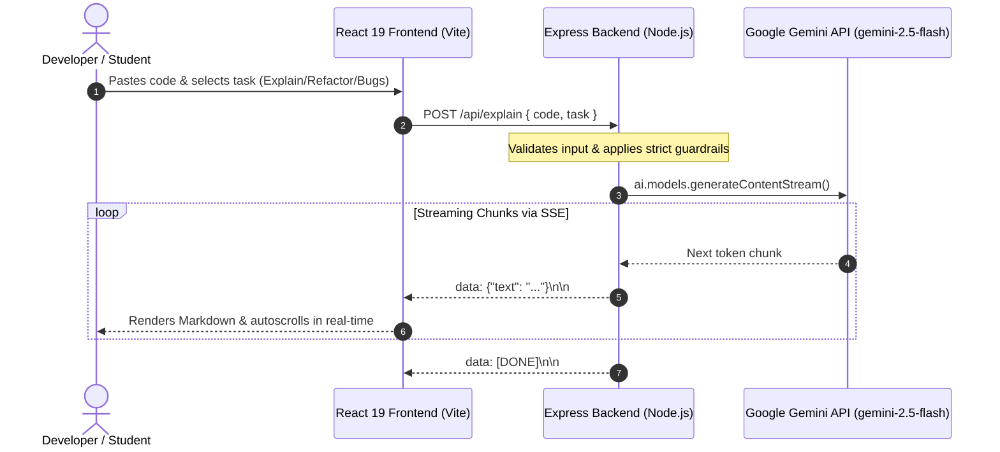

# AI Code Refiner

<p align="center">
  
  
  
  
  
  
  
</p>

An intelligent, full-stack web application that explains, refactors, and debugs code in real-time. Built with a React 19 glassmorphic frontend and an Express backend integrated with Google Gemini (`gemini-2.5-flash`) via Server-Sent Events (SSE).

🌐 **Live Demo:** [http://AI-Code-Refiner-env.eba-miqcxvnt.ap-south-1.elasticbeanstalk.com](http://AI-Code-Refiner-env.eba-miqcxvnt.ap-south-1.elasticbeanstalk.com)

---

## 📑 Table of Contents

- [Overview](#overview)
- [Key Features](#key-features)
- [Architecture & Data Flow](#architecture--data-flow)
- [Tech Stack](#tech-stack)
- [Project Structure](#project-structure)
- [Getting Started](#getting-started)
  - [Prerequisites](#prerequisites)
  - [Environment Setup](#1-environment-setup)
  - [Running with Local Node.js](#2-running-with-local-nodejs)
  - [Running with Docker](#3-running-with-docker)
- [API Reference](#api-reference)
- [Deployment on AWS Elastic Beanstalk](#deployment-on-aws-elastic-beanstalk)
- [Security & Guardrails](#security--guardrails)
- [License](#license)

---

## 💡 Overview

Developers and students frequently hit roadblocks when parsing complex algorithms, resolving subtle bugs, or discovering modern idioms to optimize existing code. 

**AI Code Refiner** provides an instant, interactive workspace where users can paste arbitrary code snippets in any major programming language (Python, C++, JavaScript, TypeScript, Go, Java, Rust, etc.) and receive token-by-token streaming insights tailored to their goal.

---

## ✨ Key Features

- ⚡ **Real-Time Token Streaming**: Streams responses via Server-Sent Events (SSE), eliminating long loading spinners and offering immediate feedback.
- 🎯 **Multi-Task Operation**:
  - **Explain Code**: Line-by-line breakdown and structural walkthrough of algorithms.
  - **Refactor & Optimize**: Clean code principles, modern language syntax, and complexity optimizations.
  - **Find Bugs**: Root-cause diagnostics for logical flaws, edge-case vulnerabilities, and syntax errors with recommended fixes.
- 🎨 **Glassmorphism UI / UX**:
  - Modern dark and light themes with auto-detection of OS color preferences.
  - Draggable, resizable split-pane layout (20% to 80% custom width).
  - Auto-scrolling output terminal with markdown formatting and code highlighting.
- 🛡️ **Strict Code-Only Guardrails**: System instructions and prompt guardrails prevent prompt injection and politely reject off-topic non-coding queries.
- 🐳 **Production Docker Container**: Production-ready image serving both the compiled React frontend and the Express backend on port `8080`.

---

## 🏗️ Architecture & Data Flow



---

## 🛠️ Tech Stack

### Frontend
- **Framework:** [React 19.2](https://react.dev/)
- **Build Tool:** [Vite 8.1](https://vitejs.dev/)
- **Markdown Parser:** [markdown-it](https://github.com/markdown-it/markdown-it)
- **Styling:** Vanilla CSS with custom glassmorphism design tokens & CSS variables
- **Linter:** [Oxlint](https://oxc.rs/)

### Backend
- **Runtime:** [Node.js](https://nodejs.org/) (v18+)
- **Web Framework:** [Express 5.2](https://expressjs.com/)
- **AI SDK:** [@google/genai](https://www.npmjs.com/package/@google/genai) (`gemini-2.5-flash`)
- **Communication:** Server-Sent Events (SSE) streaming protocol
- **Middleware:** `cors`, `dotenv`, `express.json()`

### DevOps & Cloud
- **Containerization:** Docker (`node:18-alpine`)
- **Cloud Hosting:** AWS Elastic Beanstalk (Amazon Linux 2023 Docker platform)

---

## 📂 Project Structure

```
AI-Code-Refiner/
├── backend/
│   ├── .env                  # Environment variables (GEMINI_API_KEY, PORT)
│   ├── package.json          # Express dependencies (@google/genai, cors, dotenv)
│   └── server.js             # Express API server, SSE streaming, static file serving
├── frontend/
│   ├── dist/                 # Pre-built production assets
│   ├── public/               # Public assets & icons
│   ├── src/
│   │   ├── App.jsx           # Core application layout, split-pane & SSE stream reader
│   │   ├── App.css           # Component styles
│   │   ├── index.css         # Design system tokens, glassmorphism & themes
│   │   └── main.jsx          # React DOM entry point
│   ├── package.json          # React & Vite dependencies
│   ├── vite.config.js        # Vite configuration (proxies /api to backend :8080)
│   └── README.md             # Frontend-specific documentation
├── Dockerfile                # Production container specification
├── .dockerignore             # Docker build ignores
├── concept_note.md           # Project concept & requirements document
├── project_report.md         # Comprehensive project report
└── README.md                 # Root project documentation
```

---

## 🚀 Getting Started

### Prerequisites

- **Node.js** (v18 or higher)
- **npm** or **yarn**
- **Google Gemini API Key** (Get a free key at [Google AI Studio](https://aistudio.google.com/))
- **Docker** *(optional, for running containerized)*

---

### 1. Environment Setup

Create a `.env` file inside the `backend/` directory:

```env
GEMINI_API_KEY=your_gemini_api_key_here
PORT=8080
```

> [!IMPORTANT]
> The default backend port is `8080`. Vite's development proxy in `frontend/vite.config.js` is pre-configured to forward API requests to `http://localhost:8080`.

---

### 2. Running with Local Node.js

#### Terminal 1 — Start the Backend Server:
```bash
cd backend
npm install
node server.js
```
*Backend will run at: `http://localhost:8080`*

#### Terminal 2 — Start the Frontend Development Server:
```bash
cd frontend
npm install
npm run dev
```
*Frontend will run at: `http://localhost:5173`*

Open your browser and navigate to **`http://localhost:5173`**.

---

### 3. Running with Docker

Before building the production Docker container, ensure the frontend is built:

```bash
# 1. Build frontend distribution bundle
cd frontend
npm install
npm run build
cd ..

# 2. Build Docker container
docker build -t ai-code-refiner .

# 3. Run container
docker run -p 8080:8080 -e GEMINI_API_KEY="your_gemini_api_key_here" ai-code-refiner
```

Visit **`http://localhost:8080`** to access the complete application.

---

## 📡 API Reference

### `POST /api/explain`
Receives code and analysis task, streaming back formatted markdown chunks via Server-Sent Events.

#### Request Headers
```http
Content-Type: application/json
```

#### Request Body
```json
{
  "code": "def fib(n):\n    return n if n <= 1 else fib(n-1) + fib(n-2)",
  "task": "refactor"
}
```

| Parameter | Type | Required | Values / Description |
| :--- | :--- | :--- | :--- |
| `code` | `string` | **Yes** | The source code to analyze |
| `task` | `string` | No | `"explain"` (default), `"refactor"`, or `"bugs"` |

#### Streaming Response format (`text/event-stream`)
```text
data: {"text": "### Optimizing Fibonacci\n"}

data: {"text": "The recursive approach has $O(2^n)$ time complexity..."}

data: [DONE]
```

---

## ☁️ Deployment on AWS Elastic Beanstalk

The application is deployed on AWS Elastic Beanstalk using single-container Docker.

### Step-by-Step Deployment:

1. **Build the Frontend Assets:**
   ```bash
   cd frontend
   npm run build
   cd ..
   ```

2. **Package Deployment Artifacts:**
   Create a zip bundle containing only the production assets:
   ```bash
   tar.exe -a -c -f project.zip Dockerfile .dockerignore backend/server.js backend/package.json backend/package-lock.json frontend/dist
   ```

3. **Deploy to AWS Elastic Beanstalk:**
   - Go to the **AWS Elastic Beanstalk Console**.
   - Create a new application and environment:
     - **Platform:** `Docker` (running on Amazon Linux 2023)
     - **Application code:** Choose *Upload your code* and upload `project.zip`.
   - **Environment Properties:**
     - Under *Configuration > Updates, monitoring, and routing*, add:
       - `GEMINI_API_KEY` = `<your_api_key>`
       - `PORT` = `8080`
   - **IAM Instance Profile:**
     Ensure your EC2 role has standard Elastic Beanstalk policies attached:
     - `AWSElasticBeanstalkWebTier`
     - `AWSElasticBeanstalkWorkerTier`
     - `AWSElasticBeanstalkMulticontainerDocker`
   - Click **Deploy**.

---

## 🛡️ Security & Guardrails

- **Key Isolation**: The Gemini API key remains strictly on the backend (`.env` or AWS environment variable) and is never exposed to the client bundle.
- **Strict Guardrail Prompting**: A system instruction ensures the AI operates strictly as a coding engine. Queries attempting to generate non-programming essays or off-topic content return a standardized refusal:
  > *"⚠️ **Error:** I am an AI Code Refiner. I can only analyze and process programming code. Please provide a valid code snippet."*

---

## 📄 License

This project is open-source and available under the [MIT License](LICENSE) (or provided as-is for educational purposes).
